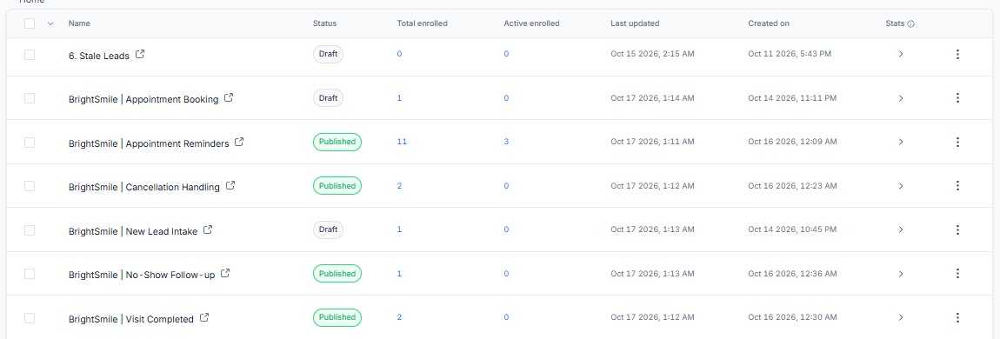
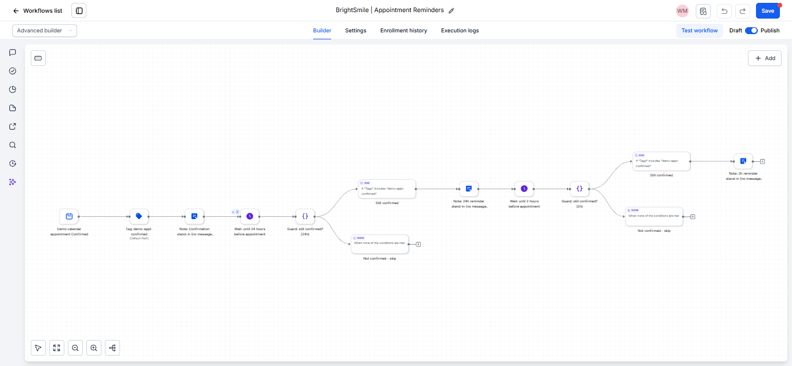
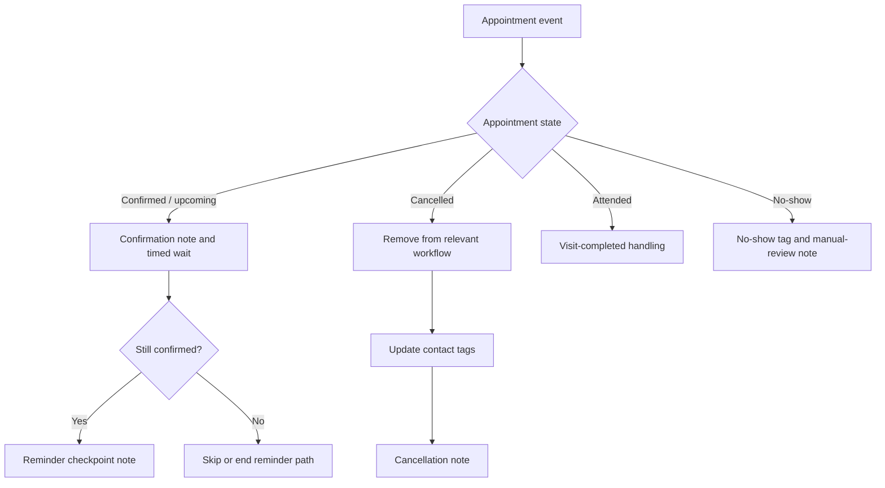
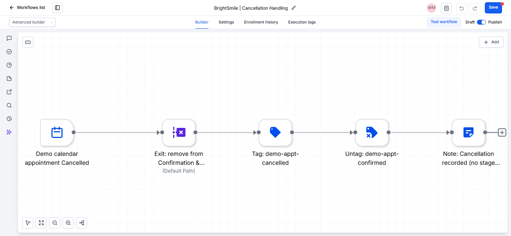
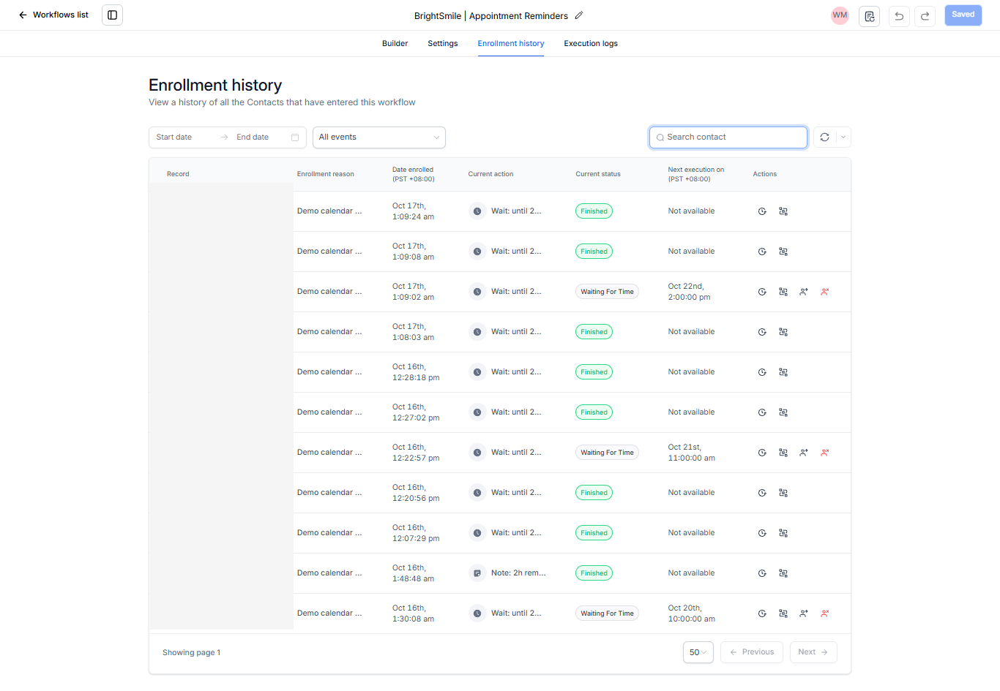
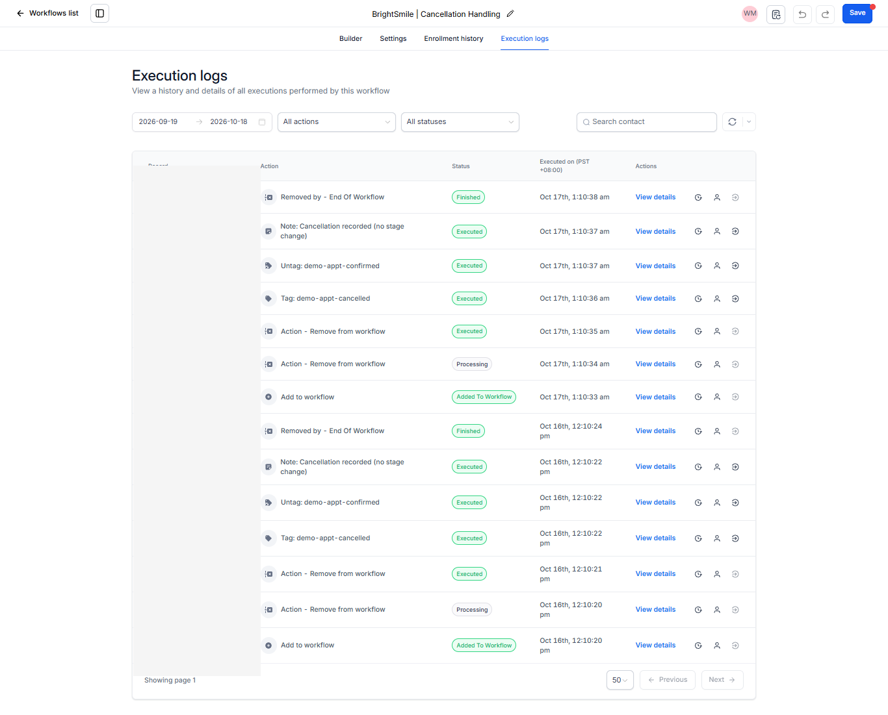
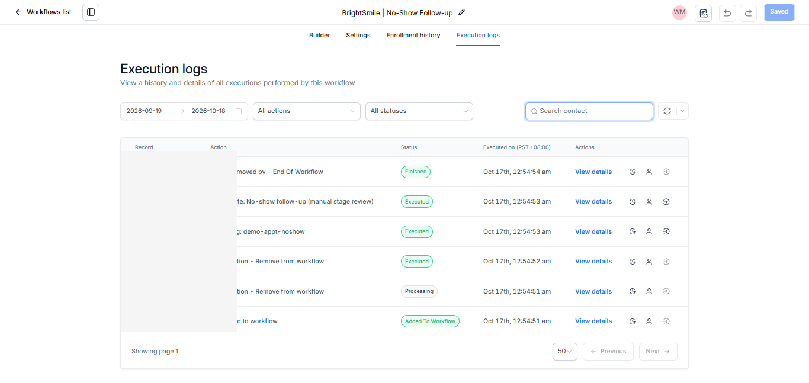

# BrightSmile Appointment Lifecycle Automation

*GoHighLevel workflow design, appointment-state handling, and lifecycle testing.*

> **Portfolio demonstration:** BrightSmile Dental Clinic and all test contacts are fictional. This project documents a configured and tested GoHighLevel demonstration, not a live clinic deployment or a production-ready system.

## Project overview

This project demonstrates appointment lifecycle automation patterns in GoHighLevel (GHL): appointment confirmation and reminder handling, cancellation handling, visit-completed handling, and no-show follow-up. The goal was to model appointment-state changes, inspect workflow execution, and document both expected behavior and defects discovered during testing.

## Workflow inventory

The project includes four lifecycle workflows:

- `BrightSmile | Appointment Reminders`
- `BrightSmile | Cancellation Handling`
- `BrightSmile | Visit Completed`
- `BrightSmile | No-Show Follow-up`

The broader BrightSmile demonstration also includes lead intake and appointment booking workflows.

*Figure 1. Workflow inventory from the GHL demonstration environment. Statuses shown are a snapshot and do not, by themselves, establish production readiness.*

## Workflow architecture

The reminder workflow uses a confirmation note, timed waits, and confirmation checks. The cancellation workflow removes the contact from relevant workflow paths, updates contact tags, and records a note. The completed-visit and no-show workflows handle their respective appointment outcomes.

*Figure 2. Appointment reminder workflow canvas. The configured checkpoint actions are notes, not actual outbound SMS or email messages.*

The architecture below summarizes the intended lifecycle logic:

*Figure 3. Cancellation handling workflow. Its contact-level tag and removal actions are relevant to the limitation found in the multiple-appointment test.*

## Testing and execution evidence

Testing covered confirmation/reminder behavior, cancellation, attendance, no-show handling, rescheduling, re-entry, and multiple appointments for one contact. The test record distinguishes passed scenarios from a pending checkpoint and a defect discovered during testing.

*Figure 4. Redacted enrollment history. The T1 reminder checkpoint was pending at the time of the supplied project record; this image is not evidence of a passing result.*

*Figure 5. Cancellation execution actions and statuses, with the contact-name column obscured.*

*Figure 6. No-show workflow execution actions and statuses, with the contact-name column obscured.*

### Test summary

| Test | Area | Recorded result |
|---|---|---|
| T1 | Confirmation/reminder path and 24-hour checkpoint | **Pending** at last verification; do not treat as passed without checking the actual execution log |
| T2 | Reminder behavior when the 24-hour wait was already overdue | Passed |
| T3 | Cancellation handling | Passed |
| T4 | Attendance handling | Passed |
| T5 | No-show handling | Passed |
| T7 | Rescheduling | Passed; old enrollment ended after appointment change and a new enrollment began with a recalculated wait |
| T8 | Re-entry after first run ended | Passed |
| T9 | Multiple appointments for one contact | Test completed; significant limitation found |

These are recorded demonstration test outcomes, not production performance metrics.

## Findings and known limitations

### Multiple appointments per contact

Cancelling one appointment ended reminder runs for another appointment belonging to the same contact. The test showed that tag and removal actions operate at contact level rather than being isolated per appointment.

### Other observed limitations

- Attendance and no-show handling left the `demo-appt-confirmed` tag on the contact.
- Rescheduling produced a duplicate confirmation note.
- Lifecycle workflows do not move an opportunity stage.
- Reminder checkpoints are notes, not actual email or SMS messages.
- Real outbound messaging, message templates, and consent handling were not tested.

Before production use, the design would need appointment-specific state handling, reliable tag cleanup, duplicate-note prevention, defined opportunity-stage behavior, and end-to-end testing of outbound messages and consent rules.

## Privacy and safety

- BrightSmile and all test contacts are fictional portfolio examples.
- Selected execution screenshots have contact-name columns obscured.
- Public evidence should not expose real contact details, record IDs, or unrelated account information.
- Workflow publication status is not proof of production readiness.

## Evidence index

The [`evidence-index.md`](documentation/evidence-index.md) file describes the selected screenshots and explains which captures were excluded from this public package.

## Tools used

- GoHighLevel: workflow builder, appointment/calendar configuration, enrollment history, execution logs, and contact records
- Markdown and Mermaid for documentation and workflow architecture

## Scope and disclosure

This is a fictional portfolio demonstration created to show workflow design, testing, and honest defect documentation. It was not deployed for a real dental clinic, and no real-world performance claims are made.
